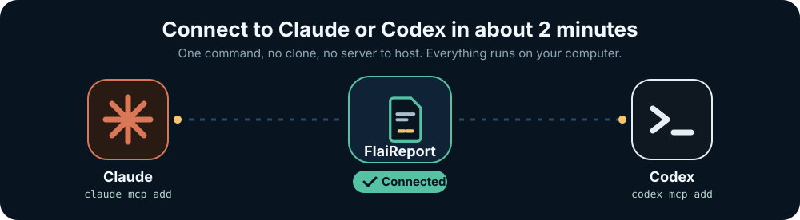
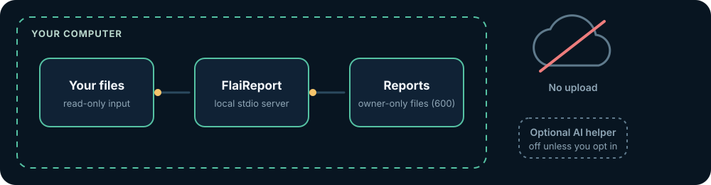
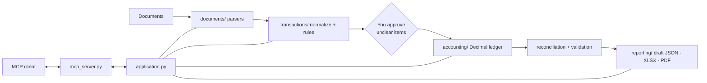

<p align="center">
  <a href="#connect-in-about-2-minutes"></a>
</p>

<p align="center">
  
</p>

<p align="center">
  <a href="https://github.com/TikStats-OU/estonian-annual-report-ai/actions/workflows/ci.yml"></a>
  <a href="LICENSE"></a>
  
  
</p>

```text
  _____ _       _ ____                       _
 |  ___| | __ _(_)  _ \ ___ _ __   ___  _ __| |_
 | |_  | |/ _` | | |_) / _ \ '_ \ / _ \| '__| __|
 |  _| | | (_| | |  _ <  __/ |_) | (_) | |  | |_
 |_|   |_|\__,_|_|_| \_\___| .__/ \___/|_|   \__|
                           |_|
   bank.csv ─┐
 stripe.csv ─┼─► parse ─► review ─► ledger ─► reconcile ─► draft for review
invoice.pdf ─┘    trace    approve   Dr = Cr   to the cent   JSON · XLSX · PDF
```

**FlaiReport** helps a small Estonian company and its accountant turn bank statements, Stripe exports, invoices, and last year's report into an annual-report draft where every figure can be traced back to a file, a page, and a row. It runs on your own computer as a set of [MCP](https://modelcontextprotocol.io) tools, so any MCP client can drive it in plain language.

> FlaiReport prepares drafts for human review. It does not give legal or tax advice, and it never signs or files anything. You still review the draft and file it in the e-Business Register yourself.

---

## Connect in about 2 minutes

You need [uv](https://docs.astral.sh/uv/) once. It also downloads Python 3.12+ for you if your computer has an older one.

```sh
curl -LsSf https://astral.sh/uv/install.sh | sh        # macOS / Linux (or: brew install uv)
```

```powershell
powershell -ExecutionPolicy ByPass -c "irm https://astral.sh/uv/install.ps1 | iex"   # Windows
```

**Step 1. Download and check (10–60 seconds the first time).**

```sh
uvx --from git+https://github.com/TikStats-OU/estonian-annual-report-ai estonian-annual-report-ai-mcp --check
```

You should see `FlaiReport … is ready: 33 MCP tools.` This also caches everything, so the client starts the server instantly later.

**Step 2. Add it to your client.** Replace the company name, registry code, and year with your own.

<details open>
<summary><b>Claude Code</b></summary>

```sh
claude mcp add flaireport --scope user \
  -e ESTONIAN_REPORT_COMPANY_NAME="Your Company OÜ" \
  -e ESTONIAN_REPORT_REGISTRY_CODE=12345678 \
  -e ESTONIAN_REPORT_YEAR=2025 \
  -- uvx --from git+https://github.com/TikStats-OU/estonian-annual-report-ai estonian-annual-report-ai-mcp
```

Check with `claude mcp list`; it should show `flaireport … ✔ Connected`.
</details>

<details open>
<summary><b>Codex</b> (CLI, IDE extension, and app share one config)</summary>

```sh
codex mcp add flaireport \
  --env ESTONIAN_REPORT_COMPANY_NAME="Your Company OÜ" \
  --env ESTONIAN_REPORT_REGISTRY_CODE=12345678 \
  --env ESTONIAN_REPORT_YEAR=2025 \
  -- uvx --from git+https://github.com/TikStats-OU/estonian-annual-report-ai estonian-annual-report-ai-mcp
```

Check with `codex mcp list`. If you skipped step 1 and the first start times out, add `startup_timeout_sec = 60` under `[mcp_servers.flaireport]` in `~/.codex/config.toml`.
</details>

<details>
<summary><b>Claude Desktop</b></summary>

Open **Settings → Developer → Edit Config** and add the server to `claude_desktop_config.json`. Desktop apps do not always see your shell `PATH`, so use the full path that `which uvx` prints (on Windows: `where uvx`).

```json
{
  "mcpServers": {
    "flaireport": {
      "command": "/full/path/to/uvx",
      "args": ["--from", "git+https://github.com/TikStats-OU/estonian-annual-report-ai", "estonian-annual-report-ai-mcp"],
      "env": {
        "ESTONIAN_REPORT_COMPANY_NAME": "Your Company OÜ",
        "ESTONIAN_REPORT_REGISTRY_CODE": "12345678",
        "ESTONIAN_REPORT_YEAR": "2025"
      }
    }
  }
}
```

Restart Claude Desktop afterwards.
</details>

**Step 3. Try it.** Ask your client: *"Use FlaiReport to tell me which documents you need for the annual report."*

Other MCP clients, Docker, `pipx`, and installing from a clone are covered in [docs/mcp-clients.md](docs/mcp-clients.md). Data is stored in `~/.local/share/estonian-annual-report-ai/data` unless you set `ESTONIAN_REPORT_DATA_DIR`.

## In plain words

Think of FlaiReport as a very careful bookkeeping assistant that refuses to guess.

- **You give it the exports you already have.** Bank CSV/XLSX/PDF, the three standard Stripe reports, invoices, and the previous annual report.
- **It reads them and keeps the receipts.** Every number remembers its source file, page, row, and the file's fingerprint (SHA-256).
- **It books only what is clear.** A bank fee is obviously a bank fee. A payment from a person with no description is not obvious, so it waits for you to say what it is.
- **It checks that everything adds up.** Opening balance plus every movement must equal the closing balance, to the cent. Stripe payouts must match what arrived in the bank.
- **It tells you what is still missing.** Instead of a nice-looking report with hidden holes, you get a list: *"approve last year's closing equity"*, *"Stripe fee report missing"*, and so on.

| You are… | FlaiReport gives you… |
| --- | --- |
| **A business owner** | A to-do list in plain language, and a draft you can hand to an accountant with all sources attached. |
| **An accountant** | A deterministic double-entry ledger, reconciliations, and an evidence registry that records what was confirmed, by whom, and from which document. |
| **A developer** | A small, tested Python codebase with a clean split between parsing, accounting, and the MCP layer. |

## How it works

<p align="center"></p>

1. **Add files.** Bank statements, Stripe reports, invoices, earlier annual reports.
2. **Read & trace.** Rows are normalized, duplicates and transfers between your own accounts are flagged, and every value keeps its source reference.
3. **You review.** Anything ambiguous is shown to you with its source. Your answers are saved as exact-match rules, so you are never asked the same thing twice.
4. **Reconcile.** Bank, Stripe, and ledger totals are checked against each other. A mismatch blocks the statements instead of being hidden.
5. **Draft.** JSON, XLSX, and PDF drafts for review, plus the list of anything still missing.

## Double-entry in one picture

<p align="center"></p>

Every transaction is recorded twice: once where the money went (debit) and once where it came from (credit). The two columns must always have the same total. If they don't, something is missing, and FlaiReport says so instead of printing a report.

```text
        Bank (asset)                 Sales (revenue)
   Dr              Cr           Dr              Cr
 ─────────────┬─────────────  ─────────────┬─────────────
  100.00      │  20.00 hosting             │  100.00
              │   5.00 card fee            │
 ─────────────┴─────────────  ─────────────┴─────────────
  balance  75.00                       100.00

  + Hosting 20.00 Dr, Card fees 5.00 Dr (expense accounts)

  Debits 125.00  =  Credits 125.00   ✓ the books balance
```

All money is handled as `Decimal` and stored in cents. There is no floating-point arithmetic anywhere in the accounting engine.

## What a session looks like

<p align="center"></p>

The draft above is blocked on purpose: last year's closing equity has not been approved yet, so the opening balance would be a guess. FlaiReport reports that instead of filling in a number.

## What it checks

| Check | What it means |
| --- | --- |
| Bank reconciliation | Opening balance + all movements = closing balance, per account and currency. |
| Duplicates | The same movement imported twice is flagged and never booked twice. |
| Own-account transfers | Equal and opposite movements between your accounts are paired, not counted as income and expense. |
| Foreign currency | Non-EUR rows need a dated, sourced EUR rate. Nothing is fetched or guessed. |
| Stripe three-way check | Balance Summary, Fees report, and itemized activity must agree, and payouts must match bank receipts. |
| Prior year | Last year's closing figures must be approved before they open this year. |
| Evidence registry | Records what you confirmed, which exports are unavailable, and which questions were already asked. |
| Pre-filing gate | Returns `READY`, `PARTIALLY READY`, or `BLOCKED` against a filing profile you configure. |

## MCP tools

The server exposes 33 tools over local stdio.

| Area | Tools |
| --- | --- |
| Import & review | `import_documents`, `parse_bank_statements`, `normalize_transactions`, `classify_transactions`, `get_unclassified_transactions`, `approve_classification`, `reconcile_accounts` |
| Statements | `generate_financial_statements`, `generate_annual_report`, `validate_annual_report`, `validate_pre_filing`, `get_missing_information` |
| Prior reports | `get_previous_report_candidates`, `approve_previous_report_value`, `get_fixed_asset_history` |
| Evidence & decisions | `get_evidence_registry`, `get_pending_evidence_questions`, `record_user_confirmation`, `mark_evidence_question_asked`, `mark_evidence_unavailable`, `record_evidence_issue`, `resolve_evidence_issue`, `evaluate_accounting_issue`, `approve_accounting_recommendation` |
| Stripe | `detect_stripe_reports`, `get_missing_stripe_reports`, `generate_stripe_download_instructions`, `import_stripe_report`, `reconcile_stripe_balances`, `reconcile_stripe_fees`, `reconcile_stripe_activity`, `match_stripe_bank_transfers`, `get_stripe_reconciliation_status` |

## Your data stays with you

<p align="center"></p>

- Documents are parsed locally. The server opens no network port and uploads nothing.
- Each company gets its own workspace. Rules, evidence, and reports are written with owner-only permissions (`0600`).
- Parser errors never include document content.
- File size, page count, row count, and XLSX archive limits protect against malformed or hostile files.
- The optional classification helper (`pip install -e ".[ai]"`) is off by default. It only runs when you pass both `use_ai` and `confirm_external_processing`, it only sees ambiguous rows, and its answers are proposals you still approve.

Keep real documents out of Git, CI logs, and shared folders. See [SECURITY.md](SECURITY.md).

## Stripe exports you need

All three come from the standard Stripe Dashboard; Sigma is not required.

1. **Balance Summary**: Reporting → Balance Summary → export CSV for the full year.
2. **Fees**: Reporting → Fees → export CSV for the same dates.
3. **Itemized activity**: Balances → All Activity → Export (includes payouts).

Use the same dates, currency, and timezone (UTC is safest) for all three. Payouts are transfers to your bank, not extra revenue, and the Fees report details fees that are already in the Balance Summary, so they are never counted twice. `generate_stripe_download_instructions` repeats these steps for whatever is still missing.

## Architecture

```text
src/estonian_annual_report_ai/
├── documents/      parse PDF / CSV / XLSX / TXT, keep page-row-sheet references
├── transactions/   normalize, classify by rule, match transfers, reconcile, FX
├── accounting/     Decimal double-entry ledger, statements, materiality decisions
├── reporting/      review-only drafts (JSON / XLSX / PDF) and the pre-filing gate
├── application.py  workflow that ties the layers together
└── mcp_server.py   thin MCP adapter: validates input, calls the workflow
```



The accounting engine does not import the parsers, the MCP layer, or the optional classification helper. MCP handlers never do arithmetic of their own.

## Known limits

- Scanned PDFs need OCR first; only text-based PDFs are read.
- Bank layouts vary. Unrecognized columns stay empty and are reported, never guessed.
- Invoices are indexed as evidence, not booked automatically: accruals, VAT, payroll, and depreciation entries still need an accountant.
- There is no XBRL export or direct e-Business Register submission. The [portal workflow](docs/e-business-register-workflow.md) is documented for manual entry.
- The reporting category (micro or small) is not decided for you.

## Run with Docker

```sh
cp .env.example .env    # adjust paths and company settings
docker compose build
docker compose run --rm annual-report-mcp
```

The container runs as a non-root user with a read-only root filesystem, no published ports, and input mounted read-only.

## Development

```sh
git clone https://github.com/TikStats-OU/estonian-annual-report-ai.git
cd estonian-annual-report-ai
python3.12 -m venv .venv && . .venv/bin/activate
python -m pip install -e ".[dev]"
python -m examples.synthetic_demo        # the accounting engine without any MCP client
python -m unittest discover -s tests -v
ruff check src mcp tests examples scripts
python scripts/check_privacy.py
python scripts/check_docs.py
```

All tests use synthetic documents. More in [CONTRIBUTING.md](CONTRIBUTING.md).

## Documentation

- [User and developer guide](docs/guide.md)
- [Connecting an MCP client](docs/mcp-clients.md)
- [Accounting helpers and decision engine](docs/accounting-support.md)
- [e-Business Register workflow](docs/e-business-register-workflow.md)
- [Research notes and official sources](docs/research-and-architecture.md)
- [Changelog](CHANGELOG.md) · [Security](SECURITY.md) · [Code of conduct](CODE_OF_CONDUCT.md)

## License

Copyright 2026 TikStats OÜ. Licensed under the [Apache License, Version 2.0](LICENSE): you may use, modify, and distribute the code, including commercially, as long as you keep the license and the [NOTICE](NOTICE). The FlaiReport and FlaiData names are not licensed for use as your own product name.
